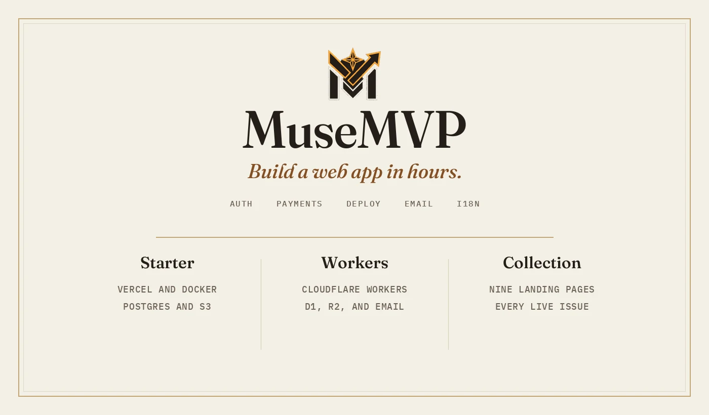

  

MuseMVP is a production Next.js starter. Auth, payments, deploy, email, i18n, and admin are already wired, so the first week goes to the product. `apps/web` deploys to Vercel or Docker. `apps/web-cloudflare` deploys to Cloudflare Workers.

  <a href="https://musemvp.com"><strong>musemvp.com</strong></a>
  &nbsp;·&nbsp;
  <a href="https://demo.musemvp.com">Demo</a>
  &nbsp;·&nbsp;
  <a href="https://musemvp.com/docs">Docs</a>
  &nbsp;·&nbsp;
  <a href="https://musemvp.com/templates">All issues</a>
  &nbsp;·&nbsp;
  <a href="https://musemvp.com/changelog">Changelog</a>

### Collection

Nine landing pages, issued beside the starter. The library includes every live issue.

<table>
  <tr>
    <td width="33%">
      <a href="https://zeus.musemvp.cn"><strong>Zeus</strong></a> 
      The night desk for operational work
    </td>
    <td width="33%">
      <a href="https://scrip.musemvp.cn"><strong>Scrip</strong></a> 
      Print the usage. Keep the books.
    </td>
    <td width="33%">
      <a href="https://hikari.musemvp.cn"><strong>Hikari</strong></a> 
      A lamp for language
    </td>
  </tr>
  <tr>
    <td>
      <a href="https://athena.musemvp.cn"><strong>Athena</strong></a> 
      The brief you can sign
    </td>
    <td>
      <a href="https://meridian.musemvp.cn"><strong>Meridian</strong></a> 
      Plot the work, keep the helm
    </td>
    <td>
      <a href="https://quire.musemvp.cn"><strong>Quire</strong></a> 
      Nested pages on a blotter
    </td>
  </tr>
  <tr>
    <td>
      <a href="https://aoi.musemvp.cn"><strong>Aoi</strong></a> 
      Name her. Keep the call.
    </td>
    <td>
      <a href="https://solis.musemvp.cn"><strong>Solis</strong></a> 
      6500K optical calibration
    </td>
    <td>
      <a href="https://kanna.musemvp.cn"><strong>Kanna</strong></a> 
      On-device, after dark
    </td>
  </tr>
</table>
